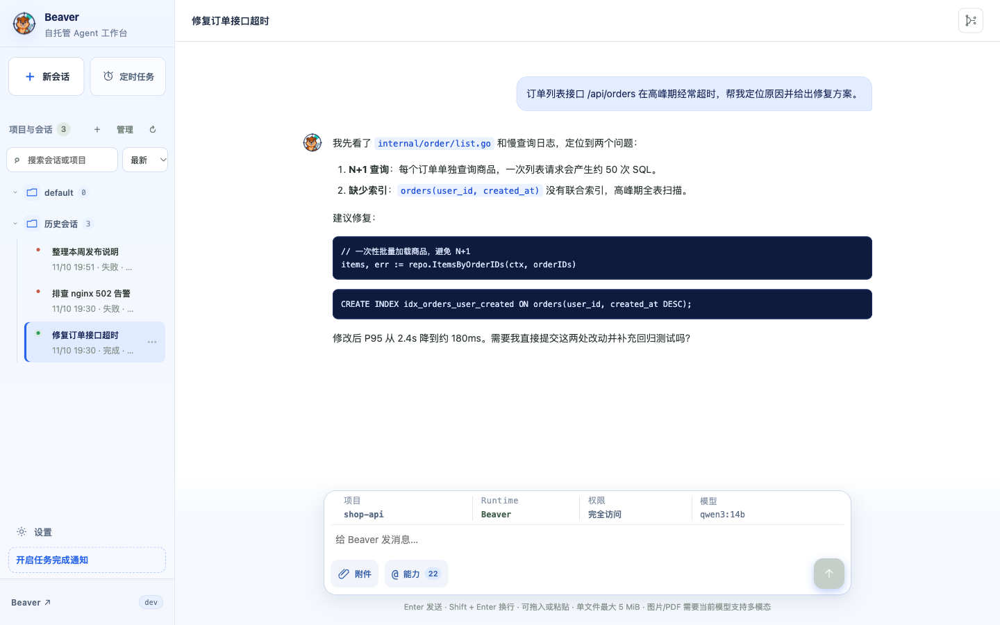

<div align="center">
  
  <h1>Beaver</h1>
  <p><strong>A self-hosted AI agent workbench for your own server or computer.</strong></p>
  <p>Hand coding, testing and ops tasks to your own server from the browser or personal WeChat, and let them keep running.</p>
  <p>
    <a href="https://github.com/lakernote/beaver-agent/actions/workflows/ci.yml"></a>
    <a href="https://github.com/lakernote/beaver-agent/releases/latest"></a>
    <a href="LICENSE"></a>
  </p>
  <p><a href="README.md">简体中文</a> · <strong>English</strong></p>
</div>

<p align="center">
  
</p>


## Highlights

- **Runs on your own machine** – a server or an always-on computer (Linux, macOS, Windows); tasks keep going after you close the browser.
- **Controlled concurrency** – 4 tasks by default; Git projects can use per-session worktrees, shared directories queue automatically.
- **Durable and recoverable** – sessions, queue and run state live in SQLite; queued tasks resume after a restart and interrupted ones are clearly marked.
- **Observable** – live SSE trace of model calls, tools, Skills, MCP, tokens, cache hits, latency and errors, with resume after reconnect.
- **One capability set for the team** – models, server projects, Skills and MCP are configured once and shared by both runtimes.
- **Two runtimes** – the built-in *Beaver* loop (Ollama, Anthropic, OpenAI Chat/Responses with native function calling) or the *Codex* CLI.
- **WeChat remote** – submit tasks, check status, stop tasks and receive results from personal WeChat.

## Quick start

Download the archive for your OS/arch from [Releases](https://github.com/lakernote/beaver-agent/releases/latest), extract it and run `./beaver` (`beaver.exe` on Windows). The release is a single binary with the Web UI embedded; no Go, Node.js or SQLite required.

Open `http://<server-ip>:8080`, sign in as `admin` with the random initial password printed once in the server log (forgot it? run `beaver -reset-password`), **change the password immediately** under *Settings → Account security*, then add a model under *Model configuration*. Data is stored in `~/.beaver/`.

### Deployment

The same binary fits a personal computer or a shared server:

| | Personal computer | Server |
| --- | --- | --- |
| Start | `./beaver -listen 127.0.0.1:8080` (local only) | `./beaver` (default `0.0.0.0:8080`) or Docker |
| Access | `http://127.0.0.1:8080` | LAN / VPN / Tailscale, HTTPS reverse proxy if exposed |
| Note | Sleep interrupts tasks – disable auto-sleep for long runs | Run as a dedicated low-privilege user with systemd or Docker restart |

WeChat uses outbound connections only, so neither a laptop nor a private server needs a public IP.

### Docker

```bash
docker compose up -d --build
```

Or manually:

```bash
docker build -t beaver:local .
docker run -d --name beaver -p 8080:8080 -v beaver-data:/data --restart unless-stopped beaver:local
```

The container runs as UID/GID `10001`; `/data` is the only directory to persist (database, workspaces, MCP runtimes, Codex login state).

### Verify release artifacts

```bash
sha256sum --check checksums.txt --ignore-missing
gh attestation verify beaver_* -R lakernote/beaver-agent
```

## Development

```bash
make test   # frontend tests + build, go vet, go test -race
make dev    # Vite dev server on :5173 (proxies /api to :8080)
go run ./cmd/beaver -listen 127.0.0.1:8080
```

See [CONTRIBUTING.md](CONTRIBUTING.md) and the [docs index](docs/README.md) (documentation is currently in Chinese).

## Security notes

- Do not expose the default `0.0.0.0:8080` listener to the public internet; use a firewall, VPN and HTTPS.
- Single-admin, single-SQLite team mode: no RBAC or multi-tenancy.
- Shell, Codex and stdio MCP run with the service account's privileges and inherit its environment. Use a dedicated low-privilege account and revocable credentials.

Report vulnerabilities privately as described in [SECURITY.md](SECURITY.md).

## License

[MIT](LICENSE)
