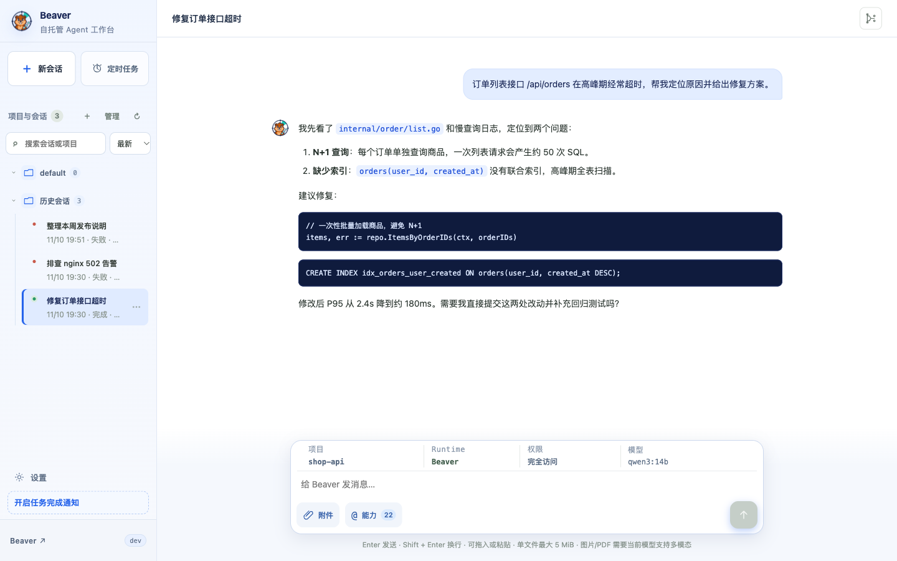
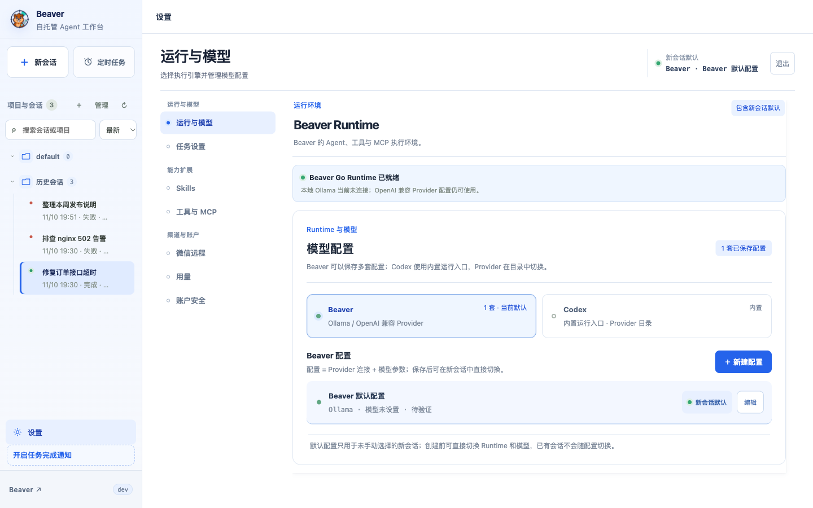
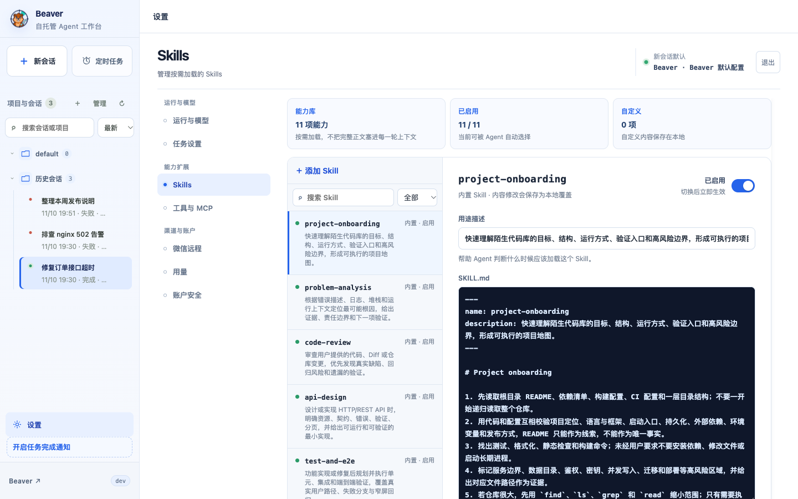

<div align="center">
  
  <h1>Beaver</h1>
  <p><strong>部署在你自己服务器或电脑上的 AI Agent 工作台。</strong></p>
  <p>通过浏览器或个人微信，把研发、测试和运维任务交给自己的机器持续执行。</p>
  <p>
    <a href="https://github.com/lakernote/beaver-agent/actions/workflows/ci.yml"></a>
    <a href="https://github.com/lakernote/beaver-agent/releases/latest"></a>
    <a href="LICENSE"></a>
  </p>
  <p><strong>简体中文</strong> · <a href="README.en.md">English</a> · <a href="docs/README.md">文档</a> · <a href="CONTRIBUTING.md">贡献</a></p>
</div>

**目录**：[能做什么](#beaver-能做什么) · [快速体验](#快速体验) · [部署方式](#部署方式) · [Docker](#docker) · [Runtime](#两种-runtime) · [内置能力](#内置能力) · [微信远程](#微信远程) · [部署前注意](#部署前注意) · [开发](#开发)

## Beaver 能做什么

| 场景 | 可以交给 Agent 的任务 |
| --- | --- |
| 研发 | 理解代码库、实现需求、修改文件、代码审查、API 设计、查询依赖文档 |
| 测试 | 编写测试、执行回归、浏览器 E2E、复现问题、验证修复结果 |
| 运维 | 检查服务和日志、定位故障、整理 RCA、核对发布流程与风险 |
| 远程协作 | 从浏览器或微信提交任务、查看状态、停止任务并接收结果 |

它主要解决这些问题：

- **任务持续在你的机器上跑**：Agent 运行在你的服务器或常开的电脑上，关闭浏览器甚至离开工位，任务也会继续执行。
- **随时随地下发**：浏览器或个人微信都能提交任务、查看状态和接收结果。
- **自选引擎**：自研轻量 Beaver Agent（任意支持 Function Calling 的模型，可本地离线）或 Codex CLI（更强的代码能力）。
- **多个任务可控并发**：默认同时运行 4 个任务；Git 项目可用 worktree 隔离，共享目录自动排队，避免互相覆盖。
- **长任务有记录、可恢复**：会话、队列和运行状态写入 SQLite；服务重启后恢复排队任务，并明确标记被中断的任务。
- **过程看得见**：通过 SSE 实时显示模型、Tool、Skill、MCP、Token、缓存、耗时和错误，网络重连后可继续 Trace。
- **团队共用一套能力**：模型配置、服务器项目、Skills 和 MCP 统一管理，同时提供给 Beaver 与 Codex Runtime。

<p align="center">
  
</p>


## 快速体验

前往 [Releases](https://github.com/lakernote/beaver-agent/releases/latest)，按系统和架构下载：

| 系统 | x64 / Intel | ARM64 / Apple Silicon |
| --- | --- | --- |
| Windows | `beaver_*_windows_amd64.zip` | `beaver_*_windows_arm64.zip` |
| macOS | `beaver_*_darwin_amd64.tar.gz` | `beaver_*_darwin_arm64.tar.gz` |
| Linux | `beaver_*_linux_amd64.tar.gz` | `beaver_*_linux_arm64.tar.gz` |

解压后运行 `beaver.exe`（Windows）或 `./beaver`（macOS/Linux）。发布包是包含 Web UI 的单个二进制，不需要安装 Go、Node.js 或 SQLite。

服务默认监听 `0.0.0.0:8080`；仅个人使用请加 `-listen 127.0.0.1:8080`。启动后访问 `http://服务器IP:8080`（本机为 `127.0.0.1`），首次启动会在日志里打印一次随机初始密码（用户名 `admin`），登录后界面会提示你在 **设置 → 账户安全** 改成自己的密码（连续 5 次登录失败会锁定 10 分钟）；忘记密码可运行 `beaver -reset-password`，然后到 **模型配置** 添加模型。

macOS 和 Windows 发布包暂未代码签名；如果首次运行被系统拦截，请在系统安全设置中确认。

### 部署方式

Linux、macOS、Windows 都可以运行，同一个二进制既适合个人电脑，也适合共享服务器：

| | 个人电脑 | 服务器 |
| --- | --- | --- |
| 适合 | 自己使用，随开随用 | 小团队共用，7×24 小时在线 |
| 启动 | `./beaver -listen 127.0.0.1:8080`，只允许本机访问 | `./beaver`（默认 `0.0.0.0:8080`）或 Docker |
| 访问 | 浏览器打开 `http://127.0.0.1:8080` | 内网 / VPN / Tailscale，必要时前置 HTTPS 反向代理 |
| 注意 | 休眠会中断任务，长任务时请关闭自动睡眠 | 用专用低权限账号运行，配置 systemd 或 Docker 自动重启 |
| 微信 | 同样可用，无需公网地址 | 同样可用 |

微信远程基于出站连接，个人电脑和内网服务器都不需要公网 IP。

### Linux x64 下载并后台启动

进入准备存放 Beaver 的目录后执行：

```bash
(
set -euo pipefail
release_url="$(curl -fsSL -o /dev/null -w '%{url_effective}' \
  https://github.com/lakernote/beaver-agent/releases/latest)"
tag="${release_url##*/}"
version="${tag#v}"
curl -fL "https://github.com/lakernote/beaver-agent/releases/download/${tag}/beaver_${version}_linux_amd64.tar.gz" \
  | tar -xz --strip-components=1
nohup ./beaver >beaver.log 2>&1 </dev/null &
printf '%s\n' "$!" >beaver.pid
)
```

```bash
tail -f beaver.log       # 查看日志
kill "$(cat beaver.pid)" # 停止服务
```

发布包已带可执行权限。数据库、默认工作区和运行状态保存在 `~/.beaver/`。

发布流程会为每个归档生成 SHA-256 校验和和 GitHub 构建来源证明。下载后可校验文件完整性，并确认产物确实由本仓库的发布工作流构建：

```bash
sha256sum --check checksums.txt --ignore-missing
gh attestation verify beaver_* -R lakernote/beaver-agent
```

### Docker

推荐使用仓库自带的 `docker-compose.yml`：`docker compose up -d --build`。容器以固定的非 root 用户（UID/GID `10001`）运行。`/data` 是唯一需要持久化的目录，包含 SQLite 数据库、默认工作区、Runtime 依赖以及 Codex 配置。也可手动运行：

```bash
docker build -t beaver:local .
docker volume create beaver-data
docker run -d --name beaver \
  -p 8080:8080 \
  -v beaver-data:/data \
  --restart unless-stopped \
  beaver:local
```

启动后访问 `http://服务器IP:8080`。使用 bind mount 时，宿主目录必须允许 UID/GID `10001` 写入。升级镜像时保留同一个 volume 即可；不要只备份 `beaver.db`，工作区、MCP Runtime 和 Codex 登录状态也位于 `/data`。

## 两种 Runtime

| | Beaver（自研轻量 Agent） | Codex CLI |
| --- | --- | --- |
| 模型 | Ollama、Anthropic、OpenAI Chat/Responses 及兼容服务，可纯本地离线 | Codex 账号或自定义网关 |
| 擅长 | 通用任务、运维排查、联网研究；一个小而透明的工具循环 | 复杂代码改动，自带沙箱与 thread |
| 要求 | 模型须支持协议原生 Function Calling | 机器上已安装并登录 Codex CLI |
| 共用 | 项目、队列、Skills、MCP、Trace 和微信入口完全一致 | 同左 |

请在运行 Beaver 的服务器终端中手动安装 Codex CLI：

```bash
curl -fsSL https://chatgpt.com/codex/install.sh | sh
```

安装命令会下载并执行 OpenAI 官方安装脚本，请在执行前核对[官方安装说明](https://developers.openai.com/codex/cli)。Beaver 只检测 Codex CLI，不会下载安装或执行该脚本。`app-server` 是 Codex CLI 自带的子命令，不需要单独安装。检测会依次检查 Beaver 服务进程的 PATH、`~/.local/bin/codex`，以及 macOS ChatGPT 应用内置的 CLI；因此本机终端、IDE 和容器若使用不同账号或环境，检测结果也可能不同。需要固定部署版本时，可给 Beaver 服务进程设置 `BEAVER_CODEX_PATH=/absolute/path/to/codex`；该值必须是绝对路径，配置错误时会直接报错而不会静默切换到另一份 CLI。两个 Runtime 共用任务队列、项目目录、worktree、Skills 和 MCP；设置中心的 Runtime 权限支持只读、工作区写入、完全访问和自定义模式，默认为完全访问。

无论选择哪个 Runtime，都使用相同的项目和任务系统：

- 项目可包含多个服务器源文件夹，第一个目录作为默认工作目录。
- 支持排队、暂停、继续、停止和重启恢复；默认并发 4、单轮最长 12 小时，均可在设置中调整。
- Git 项目可按会话创建 worktree；源仓库有未提交修改时不会自动隔离。Codex 会话还支持 thread 继续、读取和分支。

<p align="center">
  
</p>

## 内置能力

内置 Skill 只有 `code-review` 一个（也是写 Skill 的参考样例）；团队自己的方法在“Skills”页添加，两个 Runtime 共用。GitHub、Context7、Playwright、OpenAI Docs 等 MCP 可在设置页启用，供两个 Runtime 共用。

默认工具面参考 PI 保持为 `read`、`shell`、`edit`、`write` 小核心；只读模式改用文件探索核心。Skill 入口直接可用，其余内置工具和大型工具组按需加载，减少中小模型的无关 Schema 与往返。搜索后会提醒模型读取原始来源再回答。

- **任务规划**：`todo_write` 让模型在 3 步以上的复杂任务里先列清单、逐步更新，详见 [docs/tutorial/02-todo.md](docs/tutorial/02-todo.md)。
- **长期记忆**：`memory_save` / `memory_search` / `memory_forget` 把偏好和团队约定存成 `~/.beaver/memory/` 下的 Markdown，微信成员之间个人记忆相互隔离，另有一份团队共享记忆。Beaver Runtime 可读写；Codex Runtime 每轮会按消息检索相关记忆作为只读背景，新增或修改请在 Beaver Runtime 会话里进行。详见 [docs/tutorial/04-memory.md](docs/tutorial/04-memory.md)。
- **联网**：`web_search` 返回候选摘要，`web_fetch` 读取原始网页（带 SSRF 防护）。搜索后端由环境变量选择：设置 `TAVILY_API_KEY` 用 Tavily，设置 `SEARXNG_URL` 用 SearXNG，否则使用 DuckDuckGo。源码见 `internal/builtin/tools/web.go`。

### GitHub、GitLab 与 Git 凭据

- 公开仓库信息可通过 `web_fetch` 读取；需要更高限额或私有数据时使用 GitHub MCP 或服务器上的 `gh`。
- 访问私有仓库、Issue、Pull Request 和 Actions，优先到 **设置 → 工具与 MCP → GitHub** 配置官方 GitHub MCP。Bearer Token 保存在 `~/.beaver/beaver.db`，接口和页面只返回已配置状态，不回传明文；数据库本身不是独立的密钥保险库，应继续依赖目录权限、磁盘加密和低权限服务账号。
- 本地 clone、diff、commit 等操作直接使用服务器的 `git`。HTTPS 凭据、SSH Key 和 `gh`/`glab` 登录态属于运行 Beaver 的系统账号，不属于模型配置；请以同一个服务账号执行 `gh auth login` 或 `glab auth login`。GitHub/GitLab CLI 未安装时，Beaver 不会自动安装。

Shell、Codex 和 stdio MCP 继承服务账号的系统权限，服务进程环境变量也会传给子进程。不要使用个人全权限 PAT；生产环境应使用专用账号、最小权限和可轮换凭据。

<p align="center">
  
</p>

## 微信远程

- 支持多人扫码绑定，并为每个人选择新会话的默认项目。
- 文字、图片、PDF、代码文件和带微信文字的语音进入与 Web 相同的任务队列；语音没有文字时提示补发说明，不下载音频，也不运行语音识别。
- 成员 ID 由微信用户 ID 派生：同一个人重新扫码仍是同一成员，个人记忆不丢；绑定成功会自动启用微信通道。
- 定时任务可勾选要通知的成员，任务结束（成功、失败或停止）后把结果推送到他们的微信；不勾选则只在 Web 查看。主动推送沿用成员最近一条消息的会话凭据，腾讯没有公开说明限制，社区实测是：成员一段时间（短则约 2 分钟、长则十几小时）没给机器人发消息后，凭据会失效，微信返回 `ret=-2`；给机器人发任意一条消息即可恢复。详见 [教程 05](docs/tutorial/05-team-wechat.md)。
- 斜杠指令 `/new`、`/status`、`/stop`、`/projects`、`/project 名称`、`/help` 不调用模型；形如 `/stpo` 的未知命令会直接提示，文件路径等普通文本仍交给 Agent。任务运行期间微信会显示“正在输入…”（官方插件同款 `sendtyping`，不占回复条数），超过 1 分钟后会自动推送进度（进度变化才发，最多 3 条）；微信回传状态和结果，完整 Trace 保留在 Web。

## 学习与文档

项目也是一套可动手的 Agent 教材：[6 小时从 0 到 1 手搓一个 Agent](docs/tutorial/00-build-an-agent-in-6-hours.md) 从离线 Fake Model、原生 Tool Call 和可测试循环开始，再映射到 Beaver 的持久化、Trace、权限与调度；全程配套可运行的 [`examples/mini-agent`](examples/mini-agent)。90 分钟速览和三天源码路线见 [教程主页](docs/tutorial/README.md)，设计与运行原理见 [文档索引](docs/README.md)。

## 部署前注意

- 默认监听所有网卡；首次登录后请立即修改初始密码，不要直接暴露到公网，建议使用防火墙、VPN 和 HTTPS。个人电脑建议只监听 `127.0.0.1`。
- 当前是单机团队共享模式：一个管理员账号、一个 SQLite 数据库，不提供 RBAC 或多租户隔离。
- Shell、Codex 和 stdio MCP 使用 Beaver 服务进程的系统权限运行；建议使用专用的低权限账号。
- 只有任务需要调用 Git、Python、Node.js 等命令时，服务器才需要安装对应工具。

## 开发

```bash
make test   # 前端测试与构建、go vet、go test -race
make serve  # 本地一条命令：构建前端并启动 http://127.0.0.1:8080
make api    # 热更新开发：后端（:8080）；另开终端 make dev 启动 Vite 前端（:5173）
```

提交前请阅读 [CONTRIBUTING.md](CONTRIBUTING.md)；安全问题请按 [SECURITY.md](SECURITY.md) 私下报告。

## License

[MIT](LICENSE)
